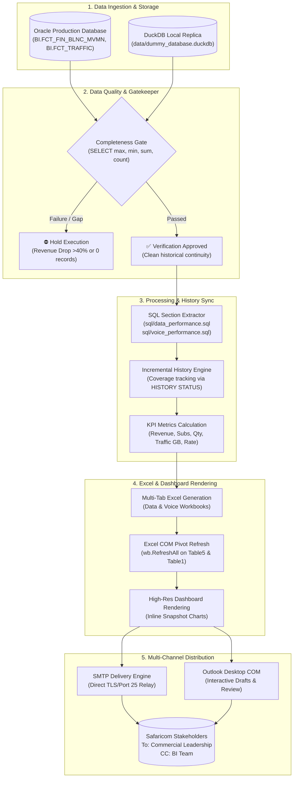
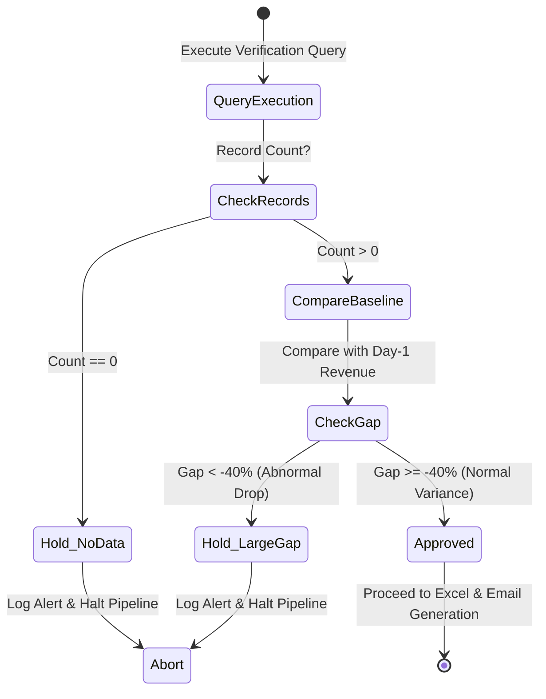
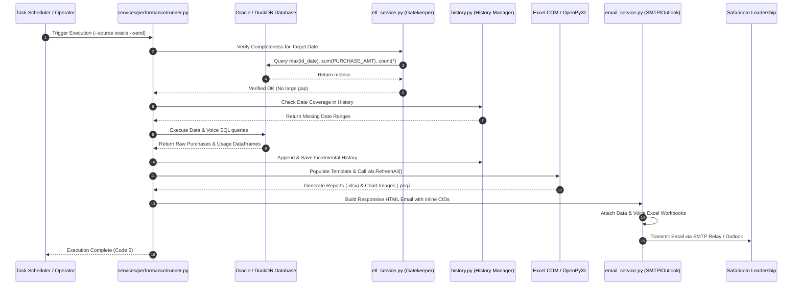

# 🌟 Safaricom Ethiopia | Bundle Performance Automation Engine
## Complete End-to-End System Architecture & Operations Guide

Welcome to the comprehensive technical documentation for the **Safaricom Ethiopia Bundle Performance Automation Engine**. This system automates the extraction, verification, historical tracking, multi-tab Excel dashboard generation, and multi-channel email distribution for Commercial Data and Voice bundle portfolios.

---

## 📑 Table of Contents

1. [Executive Summary & System Architecture](#1-executive-summary--system-architecture)
2. [Codebase & Module Layout](#2-codebase--module-layout)
3. [Data Ingestion & SQL Query Engine](#3-data-ingestion--sql-query-engine)
4. [Data Quality & Completeness Gatekeeper](#4-data-quality--completeness-gatekeeper)
5. [History Tracking & Incremental Sync](#5-history-tracking--incremental-sync)
6. [Multi-Tab Excel & Dashboard Engine](#6-multi-tab-excel--dashboard-engine)
7. [Email Generation & Delivery Pipelines](#7-email-generation--delivery-pipelines)
8. [End-to-End Execution Lifecycle](#8-end-to-end-execution-lifecycle)
9. [Operator's Playbook & CLI Commands](#9-operators-playbook--cli-commands)
10. [Troubleshooting & Maintenance](#10-troubleshooting--maintenance)

---

## 1. Executive Summary & System Architecture

The automation engine solves a core enterprise business need: delivering daily, accurate, executive-level performance reports across **Data** (Gize+, Daily, Weekly, Monthly Unlimited, Wullo/Mata) and **Voice** commercial packages to leadership with zero manual spreadsheet handling.

### High-Level Architecture Flowchart



---

## 2. Codebase & Module Layout

The codebase follows a modular design separating data extraction, reporting, history, and delivery:

```
bundle-performance/
├── .env                                # Local credentials (Oracle, SMTP, Recipient lists)
├── pyproject.toml                      # UV project configuration and dependencies
├── daily_performance_email.bat         # Batch launcher for automated scheduling
├── send_performance_email.bat          # Sample batch launcher for manual runs
├── send_performance_email.py          # Primary CLI entry point
├── bundle_performance.py              # Single-file standalone automation script
├── bundle_performance.bat             # One-click batch runner for bundle performance
│
├── config/                             # Scheduler configuration & run histories
│   ├── schedule_config.json
│   └── schedule_history.json
│
├── data/                               # Local storage & DuckDB databases
│   └── dummy_database.duckdb
│
├── docs/                               # Project documentation & guides
│   ├── PROJECT_GUIDE.md
│   └── END_TO_END_PROJECT_GUIDE.md
│
├── reports/                            # Output directory
│   ├── Archives/                       # Archived historical reports
│   ├── data/                           # Data workbooks & history (.xlsx, .png)
│   ├── voice/                          # Voice workbooks & history (.xlsx, .png)
│   ├── email_previews/                 # Desktop & mobile responsive HTML previews
│   └── logs/                           # System execution logs (performance_email.log)
│
├── services/                           # Core business logic microservices
│   ├── database.py                     # Oracle & DuckDB dual connection provider
│   ├── dummy_db.py                     # DuckDB schema & realistic sample generator
│   ├── email_service.py                # SMTP sending & Outlook COM status checkers
│   ├── etl_service.py                  # Completeness checks & table population
│   ├── performance_email.py            # Responsive HTML & plain-text email builders
│   ├── report.py                       # Native OpenPyXL multi-tab Excel builder
│   ├── scheduler.py                    # Background scheduler daemon & Windows task runner
│   │
│   ├── data/                           # Data-specific modules
│   │   ├── database.py                 # Data metric loader (Purchases & Usage)
│   │   └── report.py                   # Data workbook generator
│   │
│   ├── voice/                          # Voice-specific modules
│   │   ├── database.py                 # Voice metric loader (Purchases & Usage)
│   │   └── report.py                   # Voice workbook generator
│   │
│   ├── shared/                         # Shared utilities
│   │   ├── database.py                 # SQL file section parser & connection pool
│   │   └── excel_formatting.py         # Visual styles, fonts, borders, fills
│   │
│   └── performance/                    # Performance orchestration engine
│       ├── runner.py                   # Workflow orchestration (CLI arguments, steps)
│       ├── history.py                  # Incremental workbook history synchronization
│       ├── reporting.py                # KPI calculations & dashboard image rendering
│       └── paths.py                    # Centralized path definitions
│
├── sql/                                # Production SQL queries
│   ├── data_performance.sql           # Data purchase & usage SQL sections
│   ├── voice_performance.sql          # Voice purchase & usage SQL sections
│   └── bundle_purchase_table.sql      # Daily raw table population script
│
└── template/                           # Master Excel templates
    └── bundle_performance.xlsx         # Template with Pivot Tables & formula links
```

---

## 3. Data Ingestion & SQL Query Engine

### Dual-Database Architecture
The engine runs identically in two modes:
1. **Production Mode (`oracle`)**: Connects directly to Safaricom's Oracle Enterprise Data Warehouse via `oracledb`.
2. **Local Development Mode (`duckdb`)**: Uses a standalone DuckDB database ([`data/dummy_database.duckdb`](file:///c:/Users/Mekin.Jemal/OneDrive%20-%20Safaricom%20Ethiopia/Desktop/Automation/bundle-performance/data/dummy_database.duckdb)) for offline testing, CI/CD, and demonstrations.

### SQL Section Partitioning
Instead of scattered SQL files, queries are organized using section markers inside [`sql/data_performance.sql`](file:///c:/Users/Mekin.Jemal/OneDrive%20-%20Safaricom%20Ethiopia/Desktop/Automation/bundle-performance/sql/data_performance.sql) and [`sql/voice_performance.sql`](file:///c:/Users/Mekin.Jemal/OneDrive%20-%20Safaricom%20Ethiopia/Desktop/Automation/bundle-performance/sql/voice_performance.sql):

- `-- DATA_QUERY:PURCHASE`: Extracts daily subscriber counts (`A.SUBS`), transaction quantities (`B.QUANTITY`), and revenue in ETB (`C.REVENUE`) across all 18 bundle types.
- `-- DATA_QUERY:USAGE`: Extracts data consumption (`USAGE`) by bundle in megabytes (converted to gigabytes).
- `-- DATA_QUERY:PURCHASE_TABLE`: Populates the daily table `BUNDLE_PURCHASE_2026_09_28`.
- `-- VOICE_QUERY:PURCHASE` & `USAGE`: Extracts corresponding voice metrics.

### Dynamic Date Parameterization
The loader in [`services/shared/database.py`](file:///c:/Users/Mekin.Jemal/OneDrive%20-%20Safaricom%20Ethiopia/Desktop/Automation/bundle-performance/services/shared/database.py) parses the SQL files at runtime, injecting dates dynamically via regular expressions (`BETWEEN {{START_DATE}} AND {{END_DATE}}`). It also automatically normalizes Oracle-specific functions (such as 6-argument `REGEXP_REPLACE`) to DuckDB-compatible syntax when running in sample mode.

---

## 4. Data Quality & Completeness Gatekeeper

> [!IMPORTANT]
> The engine incorporates an automated Quality Assurance Gate (`services/etl_service.py`). An incomplete data warehouse load will never trigger a report with partial revenue numbers.

### The Verification Query
Before any report is generated, the gatekeeper queries the target date in the daily purchase table:

```sql
SELECT
    MAX(ID_DATE)        AS MAX_DATE,
    MIN(ID_DATE)        AS MIN_DATE,
    SUM(PURCHASE_AMT)   AS TOTAL_REVENUE,
    COUNT(*)            AS RECORD_COUNT
FROM
    BUNDLE_PURCHASE_2026_09_28
WHERE
    ID_DATE = {{TARGET_DATE}};
```

### Gatekeeper Evaluation Rules



1. **Zero Records (`NO_DATA`)**: If `RECORD_COUNT == 0`, execution aborts immediately with an alert that ETL has not completed.
2. **Abnormal Revenue Drop (`LARGE_GAP_HOLD`)**: If total revenue for the day drops by more than **40%** compared to the prior day without business justification, report generation halts to prevent misleading senior leadership.
3. **Approved (`VERIFIED_OK`)**: Proceeds to data transformation and report distribution.

---

## 5. History Tracking & Incremental Sync

To provide 30-day moving averages and trend lines without re-querying months of data every morning, the engine implements incremental synchronization in [`services/performance/history.py`](file:///c:/Users/Mekin.Jemal/OneDrive%20-%20Safaricom%20Ethiopia/Desktop/Automation/bundle-performance/services/performance/history.py):

### Key Characteristics:
- **Environment Isolation**: Oracle production history (`Data_Performance_History.xlsx`) and DuckDB sample history (`Data_Performance_DuckDB_History.xlsx`) are maintained separately.
- **Coverage Metadata Sheet**: Each history workbook contains a hidden worksheet named `HISTORY STATUS` tracking every collected date key (`ID_DATE`).
- **Delta Fetching**: When requested for a period (e.g., Oct 1 to Oct 30), the runner inspects `HISTORY STATUS`, identifies missing dates, queries *only* those missing days from the database, and merges them into the persistent history.
- **Composite Key Deduplication**: Records are deduplicated by `(ID_DATE, BUNDLE_NAME, METRIC)` ensuring zero duplicate rows.

---

## 6. Multi-Tab Excel & Dashboard Engine

The system features two complementary Excel generation paths:

### Method A: Master Template COM Automation (Matching Sample)
- Uses the master template [`template/bundle_performance.xlsx`](file:///c:/Users/Mekin.Jemal/OneDrive%20-%20Safaricom%20Ethiopia/Desktop/Automation/bundle-performance/template/bundle_performance.xlsx).
- Writes new raw records into Excel Tables (`Table5` on `BUNDLE PURCHASE`, `Table1` on `TRAFFIC_DATA`), which automatically expand their range.
- Invokes `wb.RefreshAll()` through Microsoft Excel COM (`win32com.client`) to refresh `PivotTable4` and `PivotTable1`.
- Recalculates all formulas across the 8 sheets:
  1. **`Summary`**: The executive dashboard block showing SUBS, QUANTITY, REVENUE, TRAFFIC, RATE (ETB/GB), and weekly moving averages (`Wk5`–`Wk13`).
  2. **`SUBS`**: Subscriber breakdown across all 18 bundles and category sub-totals.
  3. **`QUTY`**: Transaction quantity matrix.
  4. **`REVENUE`**: Revenue in ETB breakdown.
  5. **`TRAFFIC`**: Traffic volume in MB.
  6. **`BUNDLE PURCHASE`**: Raw purchases dataset and pivot table.
  7. **`TRAFFIC_DATA`**: Raw usage dataset and pivot table.
  8. **`Sheet1`**: Transposed sub-summary.

### Method B: Headless OpenPyXL Engine
For environments without Microsoft Office installed (e.g., Linux containers or headless servers), [`services/report.py`](file:///c:/Users/Mekin.Jemal/OneDrive%20-%20Safaricom%20Ethiopia/Desktop/Automation/bundle-performance/services/report.py) builds the entire multi-tab workbook with openpyxl, calculating formulas and applying styling matching Safaricom brand guidelines.

### Dashboard Image Snapshot Rendering
Using [`services/performance/reporting.py`](file:///c:/Users/Mekin.Jemal/OneDrive%20-%20Safaricom%20Ethiopia/Desktop/Automation/bundle-performance/services/performance/reporting.py), the engine renders crisp, high-resolution dashboard snapshots (`.png`) displaying:
- Revenue Contribution by Category (Donut Chart)
- Top 8 Revenue Generating Bundles (Horizontal Bar)
- Data Traffic Consumption by Category (Volume Chart)
- 30-Day Daily Revenue & Subs Trends

These images are embedded directly into the daily email body.

---

## 7. Email Generation & Delivery Pipelines

The delivery subsystem supports two delivery modes:

### 1. Direct Enterprise SMTP Relay (Default)
Handled by [`services/email_service.py`](file:///c:/Users/Mekin.Jemal/OneDrive%20-%20Safaricom%20Ethiopia/Desktop/Automation/bundle-performance/services/email_service.py):
- Connects directly to Safaricom's internal SMTP relay (Port 25 or TLS).
- Embeds dashboard images as inline MIME attachments (``).
- Attaches the complete Excel workbooks.
- Does not require Microsoft Outlook to be installed or open.

### 2. Outlook Desktop COM Integration
Handled by `displayEmail()` in [`bundle_performance.py`](file:///c:/Users/Mekin.Jemal/OneDrive%20-%20Safaricom%20Ethiopia/Desktop/Automation/bundle-performance/bundle_performance.py):
- Connects to the local Outlook Desktop client via `win32com.client`.
- Creates the message, attaches the Excel report, populates the distribution list, and saves it in the user's **Drafts** folder for review prior to dispatch.

### Configured Stakeholder Distribution List
Configured in [`.env`](file:///c:/Users/Mekin.Jemal/OneDrive%20-%20Safaricom%20Ethiopia/Desktop/Automation/bundle-performance/.env):

| Field | Stakeholders |
| :--- | :--- |
| **Sender** | `Mekin.Jemal@safaricom.et` |
| **Direct Recipients (To)** | `Kalkidan.Gero@safaricom.et`<br/>`Eden.Taddie@safaricom.et`<br/>`Ruth.Tenadam@safaricom.et`<br/>`Amit.Chandiramani@safaricom.et` |
| **CC Recipients** | `Lulae.Kassahun@safaricom.et`<br/>`Kibrom.Hadush@safaricom.et`<br/>`Betelhem.Girma@safaricom.et`<br/>`Dagim.Hailu@safaricom.et` |

---

## 8. End-to-End Execution Lifecycle

The following sequence illustrates a complete unattended run:



---

## 9. Operator's Playbook & CLI Commands

All commands are run using `uv` from the repository root:

### 1. Daily One-Click Execution
Double click [`bundle_performance.bat`](file:///c:/Users/Mekin.Jemal/OneDrive%20-%20Safaricom%20Ethiopia/Desktop/Automation/bundle-performance/bundle_performance.bat) or [`daily_performance_email.bat`](file:///c:/Users/Mekin.Jemal/OneDrive%20-%20Safaricom%20Ethiopia/Desktop/Automation/bundle-performance/daily_performance_email.bat).

### 2. Preview Only (Safe Sandbox - No Email Sent)
Generates reports, dashboard charts, and HTML previews locally:
```powershell
# Using DuckDB sample data
uv run python send_performance_email.py --source duckdb --preview-only

# Using Oracle production data
uv run python send_performance_email.py --source oracle --preview-only
```

### 3. Date-Specific Reporting
```powershell
# Single target date
uv run python send_performance_email.py --source oracle --date 20261105 --preview-only

# Custom date range
uv run python send_performance_email.py --source oracle --start 20261101 --end 20261105 --preview-only
```

### 4. Production Email Dispatch
```powershell
# Send to configured recipients
uv run python send_performance_email.py --source oracle --send

# Override recipients for an ad-hoc test
uv run python send_performance_email.py --source duckdb --send --to Mekin.Jemal@safaricom.et
```

### 5. Running the Standalone Runner (`bundle_performance.py`)
```powershell
uv run python bundle_performance.py --date=20261019
```

---

## 10. Troubleshooting & Maintenance

### Common Scenarios and Solutions

#### 1. `⛔ HOLD TRIGGERED: Data for target date is incomplete`
- **Cause:** The daily ETL in Oracle has not finished loading transactions, or total revenue is $>40\%$ below normal.
- **Action:** Check with the data engineering team if upstream tables (`BI.FCT_FIN_BLNC_MVMN`) are still loading. Re-run once loading completes.

#### 2. `PermissionError: [Errno 13] Permission denied: '...xlsx'`
- **Cause:** An existing report file or template is open in Microsoft Excel.
- **Action:** Close all Excel windows and re-run.

#### 3. `SMTP delivery failed` or Connection Refused
- **Cause:** VPN disconnected or SMTP server IP in `.env` is unreachable.
- **Action:** Ensure you are connected to the Safaricom corporate network/VPN. Verify `SMTP_SERVER` and `SMTP_PORT` in `.env`.

#### 4. Excel COM Automation Errors on Headless Servers
- **Cause:** Microsoft Excel is not installed on the server.
- **Action:** The system automatically falls back to OpenPyXL native generation without interruption.

---

> [!TIP]
> Execution logs and stack traces are continuously recorded to [`reports/logs/performance_email.log`](file:///c:/Users/Mekin.Jemal/OneDrive%20-%20Safaricom%20Ethiopia/Desktop/Automation/bundle-performance/reports/logs/performance_email.log). Always inspect this file first when debugging.
