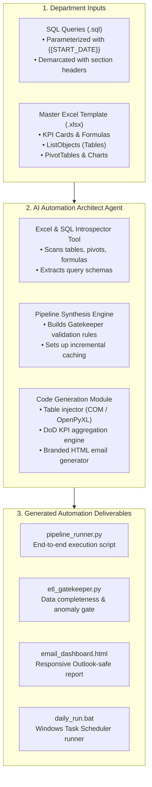
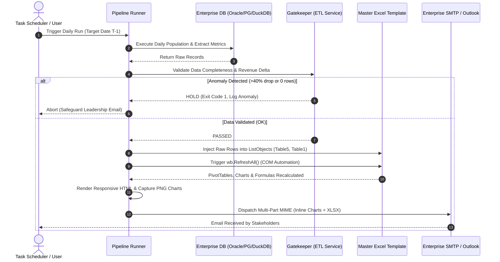
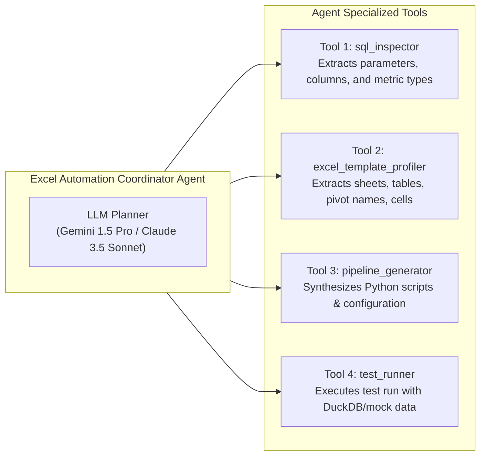

# Enterprise Excel Automation AI Agent Blueprint
## Transforming SQL Queries & Master Excel Templates into Autonomous Production Pipelines

---

## Executive Summary

Across enterprise departments—such as **Commercial (CVM/Pricing)**, **Finance (Revenue Assurance)**, **Supply Chain**, **Human Resources**, and **Network Operations**—thousands of hours are spent manually running database queries, pasting records into complex multi-tab Excel workbooks, refreshing pivot tables, capturing screenshot charts, and formatting leadership emails.

This guide provides an end-to-end blueprint for engineering an **AI Agent** capable of taking two simple department inputs:
1. **One or more SQL queries** (e.g., Oracle, PostgreSQL, Snowflake, DuckDB).
2. **A Master Excel Template (`.xlsx`)** (with existing tables, formulas, PivotTables, and charts).

And automatically generating a production-grade, unattended **Python Automation Pipeline** mirroring the proven architecture of Safaricom's commercial reporting system.



---

## 1. Core Lessons from the Safaricom Bundle Performance Engine

Before building the meta-agent, we must understand why Excel dashboard automation is notoriously difficult and how this project solved those challenges:

### The Two Strategic Architectural Approaches

| Dimension | Pattern A: Template Injection (Recommended) | Pattern B: Pure Programmatic Synthesis |
| :--- | :--- | :--- |
| **Reference File** | `sample/sales_performance.py` & `bundle_performance.py` | `services/data/report.py` & `services/voice/report.py` |
| **How it Works** | Uses an existing master `.xlsx` template. Leaves all complex formulas, pivots, and conditional formats intact. Injects new raw rows into Excel Tables (`ListObjects`), then calls `wb.RefreshAll()`. | Generates every sheet, formula, cell fill, border, and openpyxl chart programmatically from blank Python objects. |
| **Workload** | **Very Low** (Hours). Business users design and adjust the Excel dashboard visually in Excel; code only feeds raw tables. | **High** (Days/Weeks). Every row height, color code, and nested formula must be hardcoded in Python. |
| **Pivot Table Handling** | Native Excel PivotTables and PivotCharts update automatically when refreshed via Excel COM. | OpenPyXL cannot easily create or refresh PivotTables natively without Excel COM. |
| **Maintenance** | If leadership wants a new chart or changed color, edit the template in Excel—no code changes required! | Requires editing hundreds of lines of Python code and recalculating cell grid offsets. |
| **Best Used For** | **90% of Enterprise Use Cases**: Finance, Sales, CVM, Operations dashboards. | When Excel is unavailable on the host OS (Linux containers) or files must be dynamically generated from scratch. |

> [!IMPORTANT]
> **Key Principle for the AI Agent:**
> The AI Agent should default to **Pattern A (Template Injection)** whenever a user provides an existing template. It reverse-engineers the template's data dependencies, finds the raw input tables, appends the new dates, and lets Excel's native engine handle formulas and pivot calculations.

---

## 2. The 5-Stage Automation Architecture

Every departmental automation pipeline created by the agent follows this standardized 5-stage lifecycle:



### Stage 1: Parameterized SQL Section Parsing
- Queries are organized in structured `.sql` files with section banners:
  ```sql
  -- DATA_QUERY:PURCHASE
  SELECT ID_DATE, BUNDLE_NAME, PURCHASE_QTY, PURCHASE_AMT FROM ...
  WHERE ID_DATE BETWEEN {{START_DATE}} AND {{END_DATE}};

  -- DATA_QUERY:USAGE
  SELECT ID_DATE, BUNDLE_NAME, SUM(USAGE_MB) AS VALUE FROM ...
  WHERE ID_DATE BETWEEN {{START_DATE}} AND {{END_DATE}};
  ```
- The agent replaces `{{START_DATE}}` and `{{END_DATE}}` dynamically, allowing a single SQL file to serve daily runs, historical backfills, and test simulations.

### Stage 2: The Verification Gatekeeper
Never send a report with incomplete or corrupted data. The Gatekeeper runs a fast validation query:
```sql
SELECT MIN(id_date), MAX(id_date), SUM(revenue), COUNT(*)
FROM DAILY_TRANSACTIONS
WHERE id_date = {{target_date}};
```
- **Rule 1 (Zero Count):** If `count == 0` $\rightarrow$ State is `NO_DATA`. Hold report and alert engineers.
- **Rule 2 (Revenue Gap):** Compare against moving average or T-1. If revenue drop exceeds 40% without a recognized business holiday $\rightarrow$ State is `LARGE_GAP_HOLD`. Abort email dispatch.

### Stage 3: Excel Table Auto-Expansion (`ListObjects`)
When inserting data into an Excel sheet that has an official Excel Table (`ListObject`):
1. Write the new rows starting immediately on the row below the table's current bottom.
2. Excel's calculation engine automatically extends the table boundaries, calculated columns, and pivot data source references!
3. Call `workbook.RefreshAll()` via Windows COM (`win32com.client`) so all PivotTables, Slicers, and dependent chart objects re-evaluate instantly.

### Stage 4: Historical Coverage & Incremental Caching
- Maintain a hidden sheet named `HISTORY STATUS` storing all processed dates (`YYYYMMDD`).
- On every run, read `HISTORY STATUS` in $O(1)$ time to determine which dates are already cached.
- Only query the database for missing dates, collapsing contiguous gaps into minimal SQL intervals:
  `[20261015, 20261016, 20261017]` $\rightarrow$ `WHERE ID_DATE BETWEEN 20261015 AND 20261017`.

### Stage 5: Executive Delivery (HTML + Inline Charts + Attachments)
- Build a responsive HTML email featuring:
  - Corporate brand palette (e.g., Safaricom Green, Telecom Red, Executive Slate).
  - Day-over-Day (DoD) movement pills (Green $\ge 0\%$, Red $< 0\%$).
  - High-resolution embedded charts using standard Content-ID (`cid:chart_name`).
  - MSO conditional layout tables (`<!--[if mso]>`) to ensure pixel-perfect rendering across Microsoft Outlook 2016/2019/365 Desktop.

---

## 3. How the AI Agent Should Be Implemented

To allow any user from any department to generate this automation, build an **Agentic System** consisting of 4 specialized tools and a coordinator agent:



### The 4 Core Agent Tools

#### Tool 1: `sql_inspector`
- **Purpose**: Parses `.sql` files or raw query text.
- **Actions**:
  - Identifies placeholders like `{{DATE}}`, `{{START_DATE}}`, `{{END_DATE}}`.
  - Determines expected output columns and classifies them into:
    - *Temporal dimension*: `ID_DATE`, `TRANSACTION_DATE`, `PERIOD`.
    - *Categorical dimensions*: `CATEGORY`, `REGION`, `PRODUCT_NAME`, `CHANNEL`.
    - *Metrics*: `REVENUE`, `VOLUME`, `QUANTITY`, `SUBSCRIBERS`, `DURATION`.

#### Tool 2: `excel_template_profiler`
- **Purpose**: Deeply introspects an existing master `.xlsx` workbook using Python.
- **Python Implementation snippet**:
  ```python
  import openpyxl

  def profile_template(template_path: str):
      wb = openpyxl.load_workbook(template_path, data_only=False)
      profile = {"sheets": [], "tables": [], "formulas": []}
      for sheetname in wb.sheetnames:
          ws = wb[sheetname]
          tables = [t.name for t in ws.tables.values()]
          profile["sheets"].append({"name": sheetname, "tables": tables})
      return profile
  ```
- **What it identifies**:
  1. The **Raw Data Sheets** (e.g., sheets containing `ListObjects` or pure row-column tables).
  2. The **Presentation Sheets** (e.g., `Dashboard`, `Summary`, `Executive`).
  3. The **Pivot Table Sources** (identifies which raw tables feed which summaries).

#### Tool 3: `pipeline_generator`
- **Purpose**: Generates the modular Python solution files:
  - `config.json`: Database credentials, table names, email recipient distribution lists.
  - `etl_gatekeeper.py`: Verification and anomaly thresholds.
  - `data_service.py`: Query execution, dialect adaptation, and historical coverage.
  - `excel_service.py`: Table appending, formula writing, and COM `RefreshAll()` execution.
  - `email_service.py`: Responsive HTML layout, inline CID embedding, and SMTP dispatch.
  - `runner.py`: Orchestrator CLI.
  - `run.bat`: Windows Task Scheduler batch launcher.

#### Tool 4: `test_runner`
- **Purpose**: Validates the generated pipeline immediately in a sandbox:
  - Loads a slice of sample data into local DuckDB or SQLite.
  - Runs the generated runner with `--preview-only`.
  - Verifies that the Excel file was populated, tables expanded, and HTML preview created.

---

## 4. Universal Department Playbooks

Here is how the AI Agent applies this architecture across four typical enterprise departments:

### Department 1: Commercial, Pricing & CVM (Customer Value Management)
- **Business Need**: Track daily bundle purchases, revenue, active subscribers, and data/voice traffic.
- **Template Inputs**:
  - Raw Sheets: `BUNDLE PURCHASE` (`Table5`), `TRAFFIC_DATA` (`Table1`).
  - Presentation Sheets: `Dashboard` (KPI Cards: Total Revenue, Subs, Quantity, GBs, Effective Rate), `SUBS`, `REVENUE`, `TRAFFIC`.
- **Gatekeeper Metric**: Gross daily revenue vs 7-day rolling average (Alert if drop $> 35\%$).
- **Key Formulas**:
  - `Effective Rate = Total Revenue / Total GB`
  - `DoD % Change = (Today - Yesterday) / Yesterday`

### Department 2: Finance & Revenue Assurance
- **Business Need**: Daily billing vs collection reconciliation, bad debt exposure, and bank settlement gaps.
- **Template Inputs**:
  - Raw Sheets: `BILLING_CHARGES`, `PAYMENT_GATEWAY_RECEIPTS`.
  - Presentation Sheets: `Executive_Summary`, `Variance_Matrix`, `Overdue_Aging`.
- **Gatekeeper Metric**: Total billing record count $\ge 99.5\%$ of expected CDR (Call Detail Record) volume.
- **Key Formulas**:
  - `Collection Ratio = Payments_Settled / Total_Invoiced`
  - `Discrepancy Variance = Billing_Amount - Gateway_Confirmed_Amount`

### Department 3: Supply Chain & Procurement
- **Business Need**: Warehouse inventory levels, stock-out risk, purchase order fulfillment SLAs, and logistics lead time.
- **Template Inputs**:
  - Raw Sheets: `PO_TRANSACTIONS`, `WAREHOUSE_STOCK_LEVELS`.
  - Presentation Sheets: `Inventory_Pulse`, `Critical_Stock_Alerts`, `Vendor_SLA`.
- **Gatekeeper Metric**: Inventory balance check (Starting Stock + Received - Dispatched == Ending Stock).
- **Key Formulas**:
  - `Days of Inventory Remaining = Current_Stock / 30_Day_Average_Daily_Consumption`
  - `On-Time Delivery Rate = Count(Delivered_Before_SLA) / Count(Total_Orders)`

### Department 4: Network Operations (NOC)
- **Business Need**: 2G/3G/4G/5G cell site availability, drop-call rate (DCR), throughput, and high-temperature tower alarms.
- **Template Inputs**:
  - Raw Sheets: `HOURLY_SITE_KPI`, `ACTIVE_OUTAGES`.
  - Presentation Sheets: `Network_Dashboard`, `Regional_Availability`, `Worst_Cells`.
- **Gatekeeper Metric**: Total site reporting coverage (Must report $\ge 98\%$ of active towers).
- **Key Formulas**:
  - `Radio Network Availability = (Total_Cell_Hours - Outage_Hours) / Total_Cell_Hours`
  - `Drop Call Rate (DCR) = Dropped_Connections / Total_Established_Calls`

---

## 5. Complete Implementation Checklist & Next Steps

When deploying the AI Agent for a new team:

- [ ] **Step 1: Obtain the Master Template**:
  - Ask the team for their existing Excel report filled with 1 or 2 days of sample data.
  - Verify that the raw data is formatted as an **Excel Table (`ListObject`)** (e.g., using `Ctrl+T` in Excel).
- [ ] **Step 2: Collect the SQL Queries**:
  - Ensure queries accept date parameters (`{{START_DATE}}` and `{{END_DATE}}`).
  - Verify column headers match the headers expected in the raw Excel table.
- [ ] **Step 3: Define Gatekeeper Tolerances**:
  - Agree on the "Do-Not-Send" thresholds (e.g. 0 rows or revenue drop $> 40\%$).
- [ ] **Step 4: Run the Agent Generator**:
  - Run the Agent to profile the template and generate the Python automation suite.
- [ ] **Step 5: Test in Offline Preview Mode**:
  - Run with `--preview-only` to review the generated Excel file and HTML email in the browser.
- [ ] **Step 6: Register in Windows Task Scheduler**:
  - Configure the generated `.bat` file to run automatically every morning at 07:00 AM.

