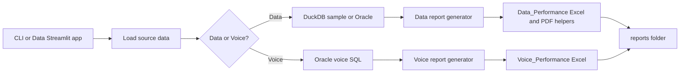
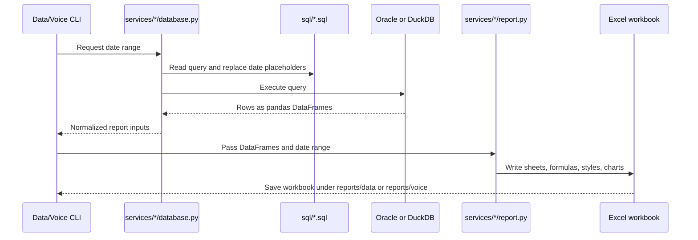

# Bundle Performance Project Guide

This guide is a practical map of the project: what it does, how the code is
organized, how to run each report, and how to learn the system one step at a
time. It describes the current implementation rather than an idealized future
design.

## 1. What the project does

The project loads Safaricom bundle performance data and turns it into Excel
reports:

- **Data performance** covers bundle purchases and data traffic. It can use
  local DuckDB sample data or Oracle production data.
- **Voice performance** covers voice bundle purchases and voice minutes. It
  requires Oracle because the local DuckDB sample database does not have the
  voice source tables.

Both reports are Excel workbooks with a dashboard, a summary, detailed metric
tabs, and hidden source/calculation tabs. The Voice dashboard is a sheet in the
Voice workbook; it is not a separate dashboard file. The existing Streamlit
application is for the Data workflow, not Voice.



## 2. First-time setup

### Requirements

- Windows is recommended. Outlook integration is Windows-only.
- Python 3.12 or newer.
- `uv` for installing and running the declared Python dependencies.
- Oracle access and credentials for production Data and all Voice reports.

### Prepare the environment

Open PowerShell in the project root and run:

```powershell
uv sync
```

For Oracle access, configure the local `.env` file with these variable names:

```dotenv
DB_USER=your_oracle_username
DB_PASSWORD=your_oracle_password
DB_DSN=your_oracle_connection_string
REPORT_EMAIL_TO=optional_default_recipient
REPORT_EMAIL_CC=optional_default_cc
```

Use the connection details issued by your database administrator. Never paste
real passwords into this guide, source files, screenshots, or commits. `.env`
is ignored by Git; keep it local.

## 3. Repository map

| Path | Purpose |
|---|---|
| `bundle_performance.py` | Main Data batch pipeline: completeness check, data load, workbook creation, and optional Outlook email. |
| `main.py` | Smaller Data CLI for explicitly selecting a source and optionally sending an email. |
| `voice_performance.py` | Voice CLI: load Oracle voice data and create one Voice Excel workbook. |
| `app.py` | Existing Streamlit interface for Data reporting and scheduling. It does not generate Voice reports. |
| `services/data/database.py` | Data-facing entry point to shared database loading functions. |
| `services/data/report.py` | Data Excel/PDF report generation and Data display-name mapping. |
| `services/voice/database.py` | Voice-facing entry point to the Oracle voice data loader. |
| `services/voice/report.py` | Voice workbook, dashboard, charts, hidden tabs, and Voice bundle display names. |
| `services/shared/database.py` | Oracle connection and shared Data/Voice query loading. |
| `services/shared/excel_formatting.py` | Reusable Excel date/week helpers, number formats, borders, and comparison colors. |
| `services/etl_service.py` | Data table population and daily completeness/gap checks. |
| `services/email_service.py` | Outlook Desktop email helper used by service-based flows. |
| `services/scheduler.py` | Data report scheduler, run history, and schedule configuration. |
| `sql/` | SQL queries used to extract Data and Voice report inputs. |
| `data/` | Local DuckDB sample database. |
| `config/` | Scheduler settings and local run history. |
| `reports/data/` | Generated Data workbooks/PDFs and their archives. |
| `reports/voice/` | Generated Voice workbooks. |
| `template/` | Workbook templates and `template/reference/` source examples. |
| `sample/` | Example implementation and sample assets. |
| `pyproject.toml`, `uv.lock` | Python dependency and environment definitions. |

Compatibility modules such as `services/report.py` and
`services/voice_report.py` remain for older imports. New code should use the
categorized `services.data` and `services.voice` modules.

## 4. Learn and run the Data workflow

### Step 1: Run a local sample

The least risky way to start is with DuckDB sample data:

```powershell
uv run python bundle_performance.py --date=20261019 --duckdb
```

To run a date range:

```powershell
uv run python bundle_performance.py --start=20261019 --end=20261025 --duckdb
```

Dates use `YYYYMMDD`. Choose a date range that exists in the sample database.
The sample database is initialized by `services/dummy_db.py`.

### Step 2: Follow the Data pipeline in order

`bundle_performance.py` is the full daily-oriented Data pipeline:

1. Parse and validate the date/source arguments.
2. Populate/check the daily purchase table through `services/etl_service.py`.
3. Check that the target date has records and that revenue did not drop beyond
   the configured gap threshold. A failed check stops report generation.
4. Load purchases and traffic using `services/data/database.py`.
5. Calculate summary KPI values for logs/email.
6. Archive older Data/legacy report files where possible.
7. Generate the Data workbook with `services/data/report.py`.
8. If Outlook is open, prepare a message. `--send` requests direct sending.

For production Data, replace `--duckdb` with `--oracle`. Oracle access and
appropriate permissions are required.

### Step 3: Know which Data command to use

| Command | Use |
|---|---|
| `uv run python bundle_performance.py --date=YYYYMMDD --duckdb` | Run the complete Data pipeline on sample data. |
| `uv run python bundle_performance.py --start=YYYYMMDD --end=YYYYMMDD --oracle` | Run the complete Data pipeline on Oracle for a period. |
| `uv run python main.py --start YYYYMMDD --end YYYYMMDD --source duckdb` | Use the smaller Data CLI without the main script's ETL orchestration. |
| `uv run streamlit run app.py` | Open the existing Data reporting/scheduling interface. |

Avoid `--send` until you have checked the report, recipient configuration, and
Outlook account: that option can send email directly. The main Data pipeline
may also create an Outlook draft when Outlook is already running.

### Step 4: Understand the Data workbook

The generated workbook is named like
`Data_Performance_<start>_<end>[_timestamp].xlsx` and is stored in
`reports/data/`.

- **Dashboard**: KPI cards and charts.
- **Summary**: daily and ISO-week comparisons across metrics.
- **SUBS**, **QUTY**, **REVENUE**, **TRAFFIC**: detailed bundle/metric views.
- **BUNDLE PURCHASE**, **TRAFFIC_DATA**, **calculations**: source or formula
  support tabs; hidden by default.

`services/shared/excel_formatting.py` contains the common conditional
formatting. Weekly grouping uses ISO calendar weeks. Subscriber totals use the
report's business-specific logic; do not replace them with a simple sum without
checking the existing formulas first.

## 5. Learn and run the Voice workflow

### Step 1: Understand the Voice inputs

Voice report creation reads three marked query sections from
`sql/voice_performance.sql`:

1. `VOICE_QUERY:PURCHASE` — distinct subscribers, purchase quantity, and
   revenue by day and bundle.
2. `VOICE_QUERY:USAGE` — minutes from the traffic source.
3. `VOICE_QUERY:FIVE_BIRR` — separate usage data needed for the five-birr
   unlimited voice bundle.

The loader in `services/shared/database.py` checks the section names and
replaces the start/end date placeholders before executing the queries.

### Step 2: Generate a Voice report

```powershell
uv run python voice_performance.py --start=20261019 --end=20261025
```

Voice defaults to Oracle. Add `--source=duckdb` to use the local synthetic
sample tables, which are created in the `VOICE` schema when they are missing:

```powershell
uv run python voice_performance.py --start=20261001 --end=20261031 --source=duckdb
```

DuckDB Voice values are generated test data, not production results. The
command creates one workbook named `Voice_Performance_<start>_<end>.xlsx` in
`reports/voice/`. It does not send an email or produce a separate dashboard
workbook.

### Step 3: Read the Voice workbook

- **Dashboard**: five KPI cards and six charts, styled to follow the Data
  dashboard.
- **Summary**: daily and weekly values for subscribers, quantity, revenue,
  minutes, and minutes per subscriber. The Metric column was removed; the
  bundle/category column is hidden.
- **SUBS**, **QUTY**, **REVENUE**, **VOICE MINUTES**: daily and weekly detail.
  Bundle/category columns are hidden to keep the metric values in view.
- **VOICE PURCHASE DATA**, **VOICE USAGE DATA**, **5 BIRR DATA**: source inputs,
  hidden by default.
- **voice_calculations**: dashboard chart/KPI support data, hidden by default.

Hidden tabs are still in the workbook. In Excel, right-click a visible sheet
tab and choose **Unhide** to inspect them.

### Step 4: Understand the Voice measures

- Purchase metrics are labeled `A.SUBS`, `B.QUANTITY`, and `C.REVENUE`.
- Subscriber values are distinct subscriber counts at the bundle/day grain.
- Weekly subscriber values use average daily values; volume measures use sums.
- Minutes per subscriber is derived from voice minutes divided by subscribers.
- Bundle identifiers used by SQL are mapped to readable labels in
  `services/voice/report.py`.
- Daily comparisons compare each day with the immediately previous day.
  Weekly comparisons compare each week with the previous week; they are
  independent and separated from daily values.

## 6. How data moves through the code



Important boundaries:

- **SQL** defines which rows and metrics are extracted.
- **Database loaders** connect to a source and return DataFrames; report
  generators should not make their own database queries.
- **Report generators** transform those DataFrames into Excel and should not
  contain connection credentials.
- **Shared helpers** are the place for formatting logic used by both workbooks.

## 7. Data shapes to recognize

The report generators expect columns to be normalized to uppercase.

### Data purchases

| Column | Meaning |
|---|---|
| `ID_DATE` | Reporting date key in `YYYYMMDD` form. |
| `BUNDLE_CATEGORY` | Bundle category. |
| `BUNDLE_NAME` | Technical bundle identifier. |
| `METRIC` | One of `A.SUBS`, `B.QUANTITY`, or `C.REVENUE`. |
| `VALUE` | Numeric measure for the row. |

### Data usage

| Column | Meaning |
|---|---|
| `ID_DATE` | Reporting date key. |
| `BUNDLE_NAME` | Technical bundle identifier. |
| `METRIC` | Usage metric, typically `USAGE`. |
| `VALUE` | Usage quantity returned by SQL. |

### Voice purchase and usage

Voice purchase rows use `ID_DATE`, `BUNDLE_NAME`, `METRIC`, and `VALUE`.
Voice usage has the same general shape; the five-birr query also returns
`CATEGORY`. The Voice report validates these required columns before it builds
the workbook.

## 8. Where to make common changes

| If you want to... | Start here |
|---|---|
| Change Data extraction or SQL aggregation | `sql/bundle_purchase.sql`, `sql/bundle_usage.sql` |
| Change Voice extraction or bundle normalization | `sql/voice_performance.sql` |
| Change Oracle/DuckDB connection and Data loading | `services/shared/database.py` |
| Change a readable bundle name | Data: `services/data/report.py`; Voice: `services/voice/report.py` |
| Change workbook sheets, formulas, or charts | The corresponding `services/data/report.py` or `services/voice/report.py` |
| Change shared comparison colors or ISO-week grouping | `services/shared/excel_formatting.py` |
| Change Data gap checks or table population | `services/etl_service.py` |
| Change Outlook service defaults | `services/email_service.py` and local environment configuration |
| Change scheduled Data execution | `services/scheduler.py` and `config/` |

Before changing a metric, trace it end-to-end: SQL output → loader DataFrame →
report formula/aggregation → visible workbook cell/chart. Keep its unit and
aggregation rule consistent at every step.

## 9. Troubleshooting

| Symptom | First checks |
|---|---|
| Oracle connection fails | Check `.env` variable names, network/VPN, DSN, account access, and date/table permissions. Do not copy credentials into logs or this guide. |
| Voice loader says DuckDB is unsupported | Expected: Voice requires Oracle source tables. Use `voice_performance.py` with working Oracle access. |
| Data quality gate stops the run | Check the target date has source rows and compare its revenue with the previous day before rerunning. Do not bypass the hold without validating the source. |
| Workbook is missing or stale | Check the CLI output path, reporting dates, and modification time in `reports/data/` or `reports/voice/`. Make sure the workbook is not open in Excel while a run tries to overwrite it. |
| Excel values look blank or stale | Formula-driven workbooks recalculate when opened in Excel; check calculation mode and unhide support tabs if needed. |
| Conditional coloring is absent | Confirm the report's metric cells have numeric values and inspect the conditional formatting rules on the relevant sheet. |
| Email did not send | Confirm Outlook Desktop is installed, open, signed in, and recipient settings are intentional. A generated workbook is not proof that an email was sent. |
| `uv` is not recognized | Install `uv`, open a new PowerShell window, then rerun `uv sync`. |

## 10. Step-by-step learning roadmap

Follow these stages in order. Each stage gives you a concrete result to check
before moving on.

### Stage 1 — Get oriented

1. Read this guide and the short project overview in `README.md`.
2. Identify the two report families and their entry points.
3. Locate the SQL, loader, report generator, and output folder for each family.

**Checkpoint:** You can explain why Data can use DuckDB while Voice requires
Oracle, and name the CLI used for each.

### Stage 2 — Run sample Data

1. Install dependencies with `uv sync`.
2. Run the Data CLI with `--duckdb` for a known sample date.
3. Open the generated workbook and inspect Dashboard, Summary, and one metric
   sheet.
4. Inspect the hidden tabs only when you need to trace a formula.

**Checkpoint:** You can follow one KPI from a DataFrame to a workbook cell.

### Stage 3 — Trace a SQL metric

1. Read the relevant SQL file.
2. Identify its output columns and metric codes.
3. Follow the loader call that executes the SQL.
4. Follow the report formula that aggregates the returned values.

**Checkpoint:** You can explain the unit and aggregation rule for one metric.

### Stage 4 — Understand workbook construction

1. Find the report generator's workbook creation function.
2. Find where dates, daily columns, and ISO-week columns are created.
3. Find where conditional formatting is applied.
4. Find how chart ranges are connected to the hidden calculation sheet.

**Checkpoint:** You can make a small styling change without changing the source
query or business aggregation.

### Stage 5 — Explore Voice after Oracle access is available

1. Read the three Voice SQL sections and their output shapes.
2. Run a small date range with `voice_performance.py`.
3. Verify the three input datasets, all six dashboard charts, and the weekly
   comparisons.
4. Compare a bundle's displayed label with the mapping in `VOICE_BUNDLES`.

**Checkpoint:** You can trace one Voice bundle's purchase and minutes values
from query output to its workbook row/chart.

### Stage 6 — Learn automation and email safely

1. Read the completeness checks before running the production Data pipeline.
2. Inspect schedule settings and run history before enabling scheduling.
3. Test email using an approved recipient and a draft/display flow first.
4. Only use direct-send switches after verifying the workbook and recipients.
5. Preview the responsive report flow with
   `uv run python send_performance_email.py --source oracle --preview-only`.
6. The manual one-click sender currently sends DuckDB sample data to
   `mekin.jemal@safaricom.et`. For production delivery, configure Oracle
   credentials and `REPORT_EMAIL_TO` in `.env`, change the sender to use
   `--source oracle --send`, then schedule it while the signed-in user and
   classic Outlook profile are available.
7. The daily job uses the last 30 days ending yesterday for its dashboard.
   Each source has separate history workbooks, preventing DuckDB sample data
   from being reused as Oracle history. It seeds DuckDB history from existing
   date-stamped reports, queries only dates missing from the requested period,
   and retains all collected dates while dashboard KPIs and charts use the
   selected period. Empty data or calculation errors stop before delivery.

**Checkpoint:** You can distinguish report creation, Outlook draft creation,
and actual email delivery.

## 11. Proposed engineering roadmap

This is a suggested improvement plan, not a claim that the items are already
implemented.

1. **Automated regression tests** — Add synthetic Data and Voice fixtures;
   verify report sheet names, daily/weekly ranges, formulas, hidden columns,
   chart labels, and conditional formatting.
2. **Data validation** — Validate required columns, date ranges, duplicates,
   numeric values, and expected metric codes before workbook generation.
3. **Operational safety** — Make source selection and Oracle fallback explicit;
   improve structured run logs and make email preview the safe default.
4. **Shared workbook utilities** — Extract only proven duplicated chart and
   workbook helpers while keeping Data and Voice business rules separate.
5. **Deployment guide** — Document an approved Windows Task Scheduler setup,
   service account permissions, Oracle connectivity, retention, and recovery.
6. **Maintenance and ownership** — Define who approves bundle mappings, SQL
   changes, recipient configuration, and production releases.

## 12. Quick command reference

```powershell
# Install dependencies
uv sync

# Data: sample database, one day
uv run python bundle_performance.py --date=20261019 --duckdb

# Data: Oracle, explicit period
uv run python bundle_performance.py --start=20261019 --end=20261025 --oracle

# Voice: Oracle, explicit period
uv run python voice_performance.py --start=20261019 --end=20261025

# Existing Data user interface
uv run streamlit run app.py
```

The commands above are examples; substitute a date range that exists in the
selected source. Review generated workbooks before distributing them.
