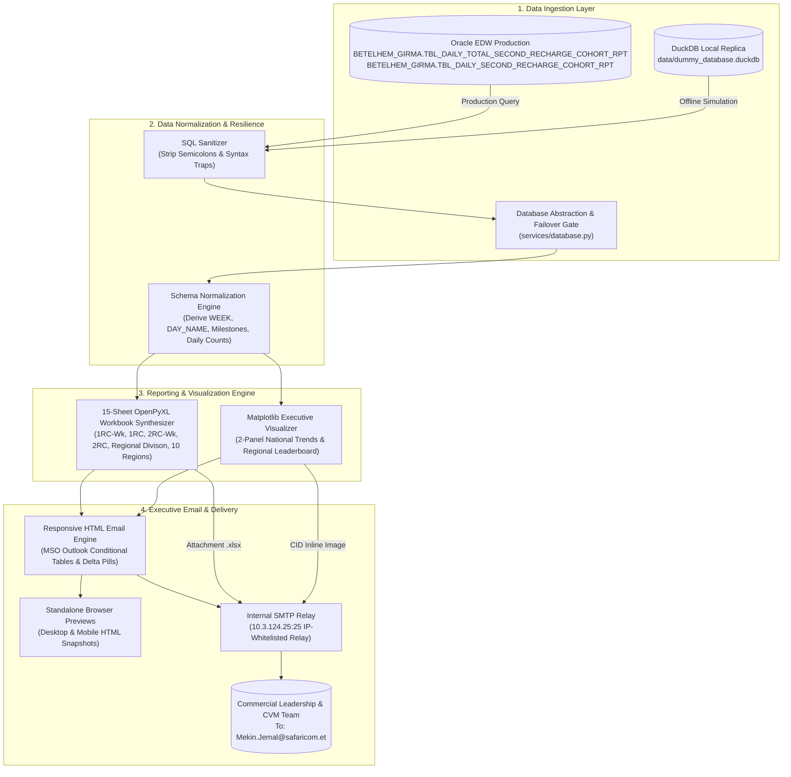

# 🌟 Safaricom Ethiopia | Daily Gross Add (KG) Recharge Tracker
## Complete End-to-End System Architecture, Business Logic & Operations Manual

---

## 📑 Table of Contents

1. [Executive Summary & Business Context](#1-executive-summary--business-context)
2. [End-to-End System Architecture](#2-end-to-end-system-architecture)
3. [Codebase & Directory Layout](#3-codebase--directory-layout)
4. [Data Ingestion & Dual-Database Layer](#4-data-ingestion--dual-database-layer)
5. [Data Normalization & Schema Resilience](#5-data-normalization--schema-resilience)
6. [Multi-Tab Excel Workbook Architecture](#6-multi-tab-excel-workbook-architecture)
7. [Executive Visual Dashboard Charting](#7-executive-visual-dashboard-charting)
8. [Responsive Executive Email Engine](#8-responsive-executive-email-engine)
9. [Operator's Playbook & CLI Commands](#9-operators-playbook--cli-commands)
10. [Troubleshooting & Maintenance Runbook](#10-troubleshooting--maintenance-runbook)

---

## 1. Executive Summary & Business Context

### What is "KG" (Kindergarten)?
In telecommunications commercial operations at Safaricom Ethiopia, **KG (Kindergarten)** refers to newly activated SIM cards—our **Daily Gross Adds**. When a customer activates a new SIM card, they enter an intensive 60-day onboarding "nursery" lifecycle (Day 0 to Day 60).

### The Business Objective
Customer Value Management (CVM) and commercial leadership must track customer recharge velocity:
- **First Recharge (1RC)**: How quickly does a subscriber make their first qualifying top-up after activation?
- **Second Recharge (2RC)**: How quickly do they commit to a repeat recharge? Second recharge velocity is the strongest leading indicator of long-term subscriber retention and 90-day activity (RGS90).
- **Exclusion of 4 Birr**: Micro-advances and loan transfers of exactly 4 Birr are excluded to evaluate genuine customer purchasing intent.

### Milestone Conversion Targets
Leadership tracks cohort conversion velocity across fixed milestone days against predefined benchmarks:

| Milestone Day | 1st Recharge (1RC) Target | 2nd Recharge (2RC) Target | Business Significance |
| :--- | :---: | :---: | :--- |
| **3 Days** | **30%** | **15%** | Immediate activation delight & first purchase impulse |
| **4 Days** | **40%** | **20%** | Early engagement & nursery onboarding stability |
| **7 Days** | **50%** | **35%** | First-week habits & initial bundle renewal |
| **10 Days** | **60%** | **40%** | Mid-term retention milestone |
| **16 Days** | **70%** | **50%** | Habitual subscriber adoption |
| **20 Days** | **90%** | **70%** | Core commercial target: confirmed active subscriber base |

---

## 2. End-to-End System Architecture

The KG Recharge Tracker automates the complete lifecycle: querying Oracle EDW or local DuckDB, normalizing disparate schema dialects, calculating non-cumulative daily counts and cumulative milestones, generating a 15-sheet formula-driven Excel workbook, rendering visual charts, and delivering an executive HTML email through Safaricom's internal SMTP relay.

### High-Level Architecture Flowchart



---

## 3. Codebase & Directory Layout

```
kg/
├── .env                                # Local configuration (DB credentials & SMTP host)
├── .python-version                     # Python 3.12 pinned version
├── pyproject.toml                      # Project metadata & UV dependencies
├── uv.lock                             # Strict dependency lockfile
├── README.md                           # Operational overview
├── send_kg_email.py                    # Primary CLI runner
├── daily_kg_email.bat                  # One-click Windows Task Scheduler batch runner
│
├── config/                             # Central settings & business constants
│   ├── __init__.py
│   └── settings.py                     # Milestone targets, canonical regions, directories
│
├── data/                               # Local storage & DuckDB database
│   └── dummy_database.duckdb           # Pre-seeded database (204 national, 810 regional rows)
│
├── docs/                               # System documentation & blueprints
│   ├── PROJECT_GUIDE.md                # Fast operational reference
│   ├── END_TO_END_PROJECT_GUIDE.md     # Comprehensive technical & architectural manual
│   └── EXCEL_AUTOMATION_AI_AGENT_BLUEPRINT.md # Enterprise AI Agentic blueprint for cohort automation
│
├── reports/                            # Output directory
│   ├── excel/                          # Generated KG_Recharge_Tracker_YYYYMMDD.xlsx
│   ├── previews/                       # Standalone desktop & mobile HTML email previews
│   └── charts/                         # Generated PNG executive dashboard charts
│
├── sql/                                # Production SQL queries
│   ├── national_cohort.sql             # National cohort query
│   └── regional_cohort.sql             # Regional query with standardized CASE ordering
│
└── src/kg/                             # Core Python package
    ├── __init__.py
    ├── assets/
    │   └── safaricom_email_footer.png  # Official Safaricom corporate email footer banner
    │
    └── services/                       # Microservices
        ├── __init__.py
        ├── dummy_db.py                 # DuckDB seeder & historical Excel extractor
        ├── database.py                 # Oracle & DuckDB dual connection provider
        ├── excel_formatting.py         # Visual styles, fonts, borders, fills & formulas
        ├── excel_report.py             # 15-sheet Excel workbook generator
        ├── visual_charts.py            # High-res 2-panel Matplotlib dashboard generator
        ├── email_template.py           # Responsive Safaricom branded HTML email builder
        ├── email_service.py            # IP-based SMTP relay client & preview saver
        └── runner.py                   # End-to-end pipeline orchestrator
```

---

## 4. Data Ingestion & Dual-Database Layer

### The Dual-Database Design Pattern
The pipeline seamlessly alternates between two database engines via [`src/kg/services/database.py`](file:///c:/Users/Mekin.Jemal/OneDrive%20-%20Safaricom%20Ethiopia/Desktop/Automation/kg/src/kg/services/database.py):

1. **Production Oracle EDW (`oracledb`)**:
   - Primary data source for unattended scheduled production runs.
   - Connects using thin-client `oracledb.connect()` to host `et02-alpha-exadb01.safaricomet.net:1521/EDWBIPR.safaricomet.net`.
2. **Local DuckDB Replica (`duckdb`)**:
   - Zero-dependency, offline local database stored at `data/dummy_database.duckdb`.
   - Pre-seeded with 102 days of national data (204 rows) and 81 days of regional data across all 10 regions (810 rows) extracted directly from the historical template.
3. **Automatic Failover Gate**:
   - If Oracle credentials are missing, VPN is disconnected, or EDW experiences network latency, the query manager catches the exception, logs a warning, and falls back to local DuckDB without aborting the pipeline.

### Production SQL Queries

#### 1. National Cohort Query ([`sql/national_cohort.sql`](file:///c:/Users/Mekin.Jemal/OneDrive%20-%20Safaricom%20Ethiopia/Desktop/Automation/kg/sql/national_cohort.sql))
```sql
SELECT *
FROM BETELHEM_GIRMA.TBL_DAILY_TOTAL_SECOND_RECHARGE_COHORT_RPT
ORDER BY ACTIVATION_DATE
```

#### 2. Regional Cohort Query ([`sql/regional_cohort.sql`](file:///c:/Users/Mekin.Jemal/OneDrive%20-%20Safaricom%20Ethiopia/Desktop/Automation/kg/sql/regional_cohort.sql))
Standardizes the 10 operating regions alphabetically with clean prefixes:
```sql
SELECT
    CASE
        WHEN L.DS_EXEC_REGION = 'West Addis'  THEN 'A.West Addis'
        WHEN L.DS_EXEC_REGION = 'East Addis'  THEN 'B.East Addis'
        WHEN L.DS_EXEC_REGION = 'Central'     THEN 'C.Central'
        WHEN L.DS_EXEC_REGION = 'South'       THEN 'D.South'
        WHEN L.DS_EXEC_REGION = 'North West'  THEN 'E.North West'
        WHEN L.DS_EXEC_REGION = 'North East'  THEN 'F.North East'
        WHEN L.DS_EXEC_REGION = 'East 1'      THEN 'G.East 1'
        WHEN L.DS_EXEC_REGION = 'East 2'      THEN 'H.East 2'
        WHEN L.DS_EXEC_REGION = 'West'        THEN 'I.West'
        WHEN L.DS_EXEC_REGION = 'North'       THEN 'J.North'
        WHEN L.DS_EXEC_REGION = 'Afar'        THEN 'K.Afar'
        ELSE 'L.Unknown'
    END AS REGION,
    L.*
FROM BETELHEM_GIRMA.TBL_DAILY_SECOND_RECHARGE_COHORT_RPT L
WHERE L.DS_EXEC_REGION IN (
    'East Addis', 'West Addis', 'Central', 'South', 'West',
    'East 1', 'East 2', 'North West', 'North East', 'North'
)
AND L.REPORT_TYPE = '2nd Purchase'
ORDER BY REGION, ACTIVATION_DATE
```

> [!IMPORTANT]
> **Oracle OCI Wire Protocol & Semicolons:**
> In Oracle DB-API (`oracledb`), ending SQL queries with a trailing semicolon (`;`) raises `ORA-00933: SQL command not properly ended`. The query sanitizer in `read_sql_file()` automatically strips all trailing semicolons and extraneous whitespace.

---

## 5. Data Normalization & Schema Resilience

Raw Oracle tables often exhibit schema drift: column headers may appear as `DAY_LABEL` instead of `WEEK`, or dates may be stored in varying string formats. 

The [`normalize_cohort_dataframe()`](file:///c:/Users/Mekin.Jemal/OneDrive%20-%20Safaricom%20Ethiopia/Desktop/Automation/kg/src/kg/services/database.py) function acts as a resilient gatekeeper:

```mermaid
flowchart LR
    Raw_Data["Raw SQL Output\n(Oracle / DuckDB)"] --> Uppercase["1. Uppercase & Strip Headers"]
    Uppercase --> Date_Resolve["2. Resolve ACTIVATION_DATE\n(Check DATE, ACT_DATE, ID_DATE)"]
    Date_Resolve --> Week_Derive["3. Derive WEEK\n(Extract from DAY_LABEL or compute from min date)"]
    Week_Derive --> Day_Derive["4. Derive DAY_NAME\n(Day of week string: Saturday, Sunday...)"]
    Day_Derive --> Counts_Resolve["5. Standardize DAY_0..DAY_60\n(Map D0..D60 or compute from sums)"]
    Counts_Resolve --> Rates_Resolve["6. Calculate Milestone Rates\nPCT_3D, PCT_4D, PCT_7D, PCT_10D, PCT_16D, PCT_20D"]
    Rates_Resolve --> Clean_DF["Guaranteed Canonical DataFrame"]
```



### Derived Column Matrix

| Target Canonical Field | Candidate Source Columns | Fallback Resolution Logic |
| :--- | :--- | :--- |
| `ACTIVATION_DATE` | `ACTIVATION_DATE`, `ACT_DATE`, `COHORT_DATE`, `ID_DATE` | Parses into `datetime64[ns]` |
| `WEEK` | `WEEK`, `COHORT_WEEK`, `WK`, `WEEK_LABEL`, `DAY_LABEL` | If `DAY_LABEL = 'WK2 Tuesday'`, splits string to `'WK2'`. If missing, calculates `Wk{days // 7 + 1}` |
| `DAY_NAME` | `DAY_NAME`, `DAY`, `DAY_LABEL` | Extracts second token of `DAY_LABEL` or computes `date.strftime("%A")` |
| `KG_BASE` | `KG_BASE`, `BASE`, `TOTAL_BASE`, `TOTAL_SIMS`, `GA` | Coerces to integer; defaults to 0 |
| `REPORT_TYPE` | `REPORT_TYPE`, `TYPE`, `RECHARGE_TYPE` | Standardized to `'1st Purchase'` or `'2nd Purchase'` |
| `DAY_0` to `DAY_60` | `DAY_0`, `D0`, `DAY0` | Ensures all 61 daily integer count columns exist |
| `PCT_3D` to `PCT_20D` | `PCT_3D`, `PCT_7D`... | If missing, computes `SUM(DAY_0..DAY_N) / KG_BASE` |

---

## 6. Multi-Tab Excel Workbook Architecture

The generated workbook ([`KG_Recharge_Tracker_YYYYMMDD.xlsx`](file:///c:/Users/Mekin.Jemal/OneDrive%20-%20Safaricom%20Ethiopia/Desktop/Automation/kg/reports/excel/)) contains 15 interconnected sheets. It follows Safaricom's visual identity with soft blues, greens, thin grid borders, and dynamic native Excel formulas.

```
┌────────────────────────────────────────────────────────────────────────┐
│                   KG_Recharge_Tracker_YYYYMMDD.xlsx                     │
├─────────────────┬──────────────────┬─────────────────┬─────────────────┤
│ 1RC-Wk (Summary)│ 1RC (Detail)     │ 2RC-Wk (Summary)│ 2RC (Detail)    │
├─────────────────┼──────────────────┴─────────────────┴─────────────────┤
│ 2RC-Wk (Divison)│ Consolidated Regional Second Recharge Comparison     │
├─────────────────┼──────────────────────────────────────────────────────┤
│ 10 Regional     │ 2RC (East ADDIS), 2RC (West ADDIS), 2RC (Central),   │
│ Detail Tabs     │ 2RC (South), 2RC (West), 2RC (East 1), 2RC (East 2), │
│                 │ 2RC (North West), 2RC (NorthEast), 2RC (North)       │
└─────────────────┴──────────────────────────────────────────────────────┘
```

### Detailed Tab Specifications

#### Tab 1 & Tab 3: National Summaries (`1RC-Wk` & `2RC-Wk`)
- **Purpose**: High-level weekly cohort progression.
- **Formulas**:
  - Weekly Milestone Rate: Dynamic `=IFERROR(AVERAGEIFS('2RC'!F:F,'2RC'!$B:$B,$D4),"")`
  - 4-Week Average: `=AVERAGE(E4:E7)`
  - Week-on-Week Differences (pp): `=IFERROR(E10-E9," ")`

#### Tab 2 & Tab 4: National Daily Details (`1RC` & `2RC`)
- **Purpose**: Daily cohorts from Day 0 through Day 60.
- **Freeze Panes**: Locked on column `F4` (Columns B to E frozen while scrolling right).
- **Formulas**:
  - **3 Days**: `=SUM(L4:N4)/E4` *(Day 0 + Day 1 + Day 2)*
  - **4 Days**: `=SUM(L4:O4)/E4` *(Day 0..Day 3)*
  - **7 Days**: `=SUM(L4:R4)/E4` *(Day 0..Day 6)*
  - **10 Days**: `=SUM(L4:U4)/E4` *(Day 0..Day 9)*
  - **16 Days**: `=SUM(L4:AA4)/E4` *(Day 0..Day 15)*
  - **20 Days**: `=SUM(L4:AE4)/E4` *(Day 0..Day 19)*
  - **Timing Buckets (2RC)**:
    - `Total`: `=SUM(L4:BT4)/E4` *(60-day conversion)*
    - `Day 1`: `=L4/$E4` *(Day 0 conversion)*
    - `Day 2–5`: `=SUM(M4:P4)/$E4` *(Day 1..Day 4)*
    - `>5 to 10`: `=SUM(Q4:U4)/$E4` *(Day 5..Day 9)*
    - `>10 to 15`: `=SUM(V4:Z4)/$E4` *(Day 10..Day 14)*
    - `>15`: `=SUM(AA4:BE4)/$E4` *(Day 15..Day 30)*

#### Tab 5: Regional Consolidated Summary (`2RC-Wk (Divison)`)
- **Structure**: Grouped headers for all 10 regions placed side-by-side.
- **Formulas**:
  - Cross-sheet references: `=IFERROR(AVERAGEIFS('2RC (East ADDIS) '!F:F,'2RC (East ADDIS) '!$B:$B,$C5),"")`
  - 4-Week Averages: `=AVERAGE(D12:D15)`
  - After vs Before Comparison: `=IFERROR(D16-D11,"")`
  - 20-Day Target Comparison: `=I16-70%`

#### Tabs 6–15: Regional Detail Sheets
- Individual daily cohort sheets for each of the 10 operating regions:
  - `2RC (East ADDIS) `
  - `2RC (West ADDIS)`
  - `2RC (Central) `
  - `2RC (South) `
  - `2RC (West) `
  - `2RC (East 1) `
  - `2RC (East 2) `
  - `2RC (North West) `
  - `2RC (NorthEast)`
  - `2RC (North) `

---

## 7. Executive Visual Dashboard Charting

The [`src/kg/services/visual_charts.py`](file:///c:/Users/Mekin.Jemal/OneDrive%20-%20Safaricom%20Ethiopia/Desktop/Automation/kg/src/kg/services/visual_charts.py) engine renders a high-resolution, 2-panel executive dashboard (`reports/charts/kg_dashboard_YYYYMMDD.png`):

```
┌────────────────────────────────────────┬────────────────────────────────────────┐
│ Panel 1: National Weekly Milestone     │ Panel 2: Regional 20-Day Second        │
│ Progression (WK1..WKn)                 │ Recharge Conversion vs 70% Target      │
│                                        │                                        │
│  80% ┼───-─-─-─-─-─-─-─- 20D Target 70%│  East Addis  █████████████ 48.2%       │
│  60% ┼───●───●───●───●  20-Day Rate    │  West Addis  ████████████  46.1%       │
│  40% ┼───▲───▲───▲───▲  7-Day Rate     │  Central     ███████████   42.8%       │
│  20% ┼───■───■───■───■  3-Day Rate     │  South       ██████████    38.5%       │
│   0% └───┴───┴───┴───┴──────────────── │              0%        35%        70% │
└────────────────────────────────────────┴────────────────────────────────────────┘
```

- **Panel 1**: Line charts tracking 3D, 7D, 16D, and 20D conversion trends across cohort weeks against horizontal benchmark lines (70% and 35%).
- **Panel 2**: Horizontal ranking of all 10 regions on 20-day conversion rate, highlighting top performers in Deep Forest Green and lagging regions in Amber.

---

## 8. Responsive Executive Email Engine

The email system delivers an executive-grade HTML experience in Microsoft Outlook desktop while remaining fluid on mobile screens.

```
┌────────────────────────────────────────────────────────┐
│ [CVM & Onboarding] Daily Gross Add (KG) Recharge Report│
│ As of: 10 November 2026                                │
├──────────────┬──────────────┬──────────────┬───────────┤
│ Gross Adds   │ 1RC 20D Avg  │ 2RC 20D Avg  │ Top Region│
│  2,990,442   │    54.2%     │    37.1%     │East Addis │
│ Active SIMs  │ Target: 90%  │ Target: 70%  │   48.2%   │
├──────────────┴──────────────┴──────────────┴───────────┤
│ [Embedded Visual Dashboard Chart]                      │
├────────────────────────────────────────────────────────┤
│ National 2nd Recharge Milestone Progression Table      │
│ Cohort Week │ KG Base │ 3 Days │ 7 Days │ 16D │ 20 Days│
├────────────────────────────────────────────────────────┤
│ Regional Second Recharge Division Leaderboard          │
│ Rank │ Region │ KG Base │ 3D │ 7D │ 16D │ 20D vs Target│
├────────────────────────────────────────────────────────┤
│ Executive Commercial Commentary & Key Takeaways        │
├────────────────────────────────────────────────────────┤
│ [Safaricom Ethiopia Corporate Footer Banner]           │
└────────────────────────────────────────────────────────┘
```

### Key Engineering Features
1. **MSO Conditional Formatting (`<!--[if mso]>`)**: Restricts table width to a rigid 800px on desktop Outlook to prevent distorted column blowing.
2. **Dual-Rendering Image Engine**:
   - **Local Previews**: Images encoded as `data:image/png;base64,...` so files can be opened in any web browser without an HTTP server.
   - **SMTP Dispatch**: Images embedded as MIME Content-IDs (`cid:safaricom_email_footer`, `cid:kg_performance_dashboard`) for seamless Outlook display without "Click here to download pictures" blocks.
3. **Internal SMTP Relay (`10.3.124.25:25`)**: Connects directly using IP-based whitelisting—eliminating username, password, and SSL handshake failures.

---

## 9. Operator's Playbook & CLI Commands

All commands run through `uv` from the `kg` project directory:

```powershell
cd "c:\Users\Mekin.Jemal\OneDrive - Safaricom Ethiopia\Desktop\Automation\kg"
```

### 1. Offline Development & Verification (DuckDB)
Generate the complete 15-sheet Excel workbook, render charts, and build browser HTML previews without connecting to Oracle or sending emails:

```powershell
uv run python send_kg_email.py --source duckdb --preview-only
```

### 2. Production Run (Oracle EDW)
Query production EDW tables with automatic DuckDB fallback protection:

```powershell
uv run python send_kg_email.py --source oracle --preview-only
```

### 3. Production Dispatch (Email Send)
Execute data extraction, generate reports, and dispatch the executive email to the configured recipient list via the internal SMTP relay:

```powershell
uv run python send_kg_email.py --source oracle --send
```

### 4. Recipient Override for Ad-Hoc Testing
```powershell
uv run python send_kg_email.py --source duckdb --send --recipient "your.email@safaricom.et"
```

### 5. Windows Task Scheduler Automated Batch
To run unattended daily at 07:00 AM, point Windows Task Scheduler to:
```bat
c:\Users\Mekin.Jemal\OneDrive - Safaricom Ethiopia\Desktop\Automation\kg\daily_kg_email.bat
```

---

## 10. Troubleshooting & Maintenance Runbook

### Error 1: `ORA-00933: SQL command not properly ended`
- **Root Cause**: SQL query ends with a semicolon (`;`). Python Oracle DB-API prohibits semicolons over the wire.
- **Solution**: Semicolons are stripped automatically in `read_sql_file()`. Ensure manual queries executed in testing do not append `;`.

### Error 2: `ORA-00942: table or view does not exist`
- **Root Cause**: Missing schema qualification. When connecting as `svc-cbu-pam9`, tables belonging to Betelhem Girma require the schema prefix.
- **Solution**: Always query `BETELHEM_GIRMA.TBL_DAILY_SECOND_RECHARGE_COHORT_RPT` rather than the bare table name.

### Error 3: `KeyError: 'WEEK'`
- **Root Cause**: The source Oracle table uses `DAY_LABEL` (e.g. `'WK2 Tuesday'`) rather than `WEEK`.
- **Solution**: Handled automatically by `normalize_cohort_dataframe()`, which derives `WEEK` and `DAY_NAME` dynamically.

### Error 4: `Failed to install oracledb: incompatible hardlinks (os error 396)`
- **Root Cause**: Windows OneDrive cloud-synced folders do not support NTFS hardlinks when UV populates `.venv`.
- **Solution**: Always run UV sync with copy mode:
  ```powershell
  uv sync --link-mode copy
  ```

### Error 5: `SMTP delivery failed: [WinError 10060] Connection timed out`
- **Root Cause**: Source machine is disconnected from Safaricom corporate network/VPN or SMTP host `10.3.124.25` is unreachable.
- **Solution**: Confirm corporate network connectivity:
  ```powershell
  Test-NetConnection -ComputerName 10.3.124.25 -Port 25
  ```
