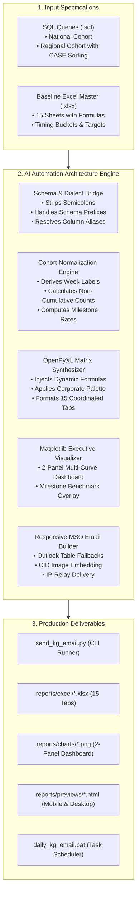
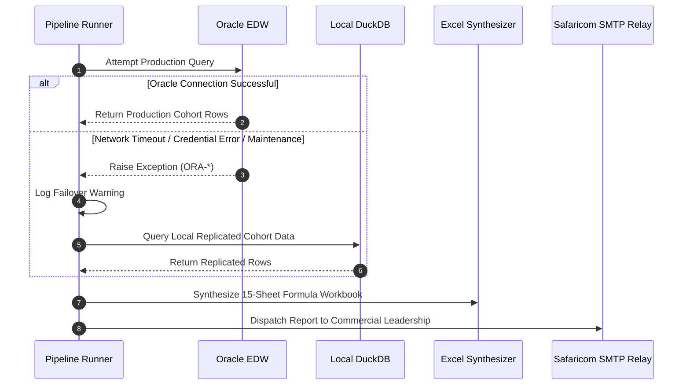
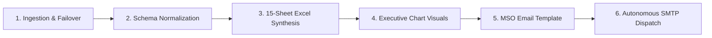

# 🧠 Enterprise Excel Automation AI Agent Blueprint
## Designing Autonomous Multi-Tab Cohort Engines, Formula Synthesizers & Executive Delivery Systems

---

## Executive Summary

Across modern telecom, fintech, and banking enterprises, **Cohort Analysis** is the gold standard for measuring customer lifecycle health. Whether tracking newly activated SIM cards (**Daily Gross Adds / KG**), mobile money wallet activations (**M-PESA**), or enterprise accounts, commercial teams must observe customer behavior across sliding observation windows (Day 0 through Day 60).

However, reporting this manually creates massive operational drag:
- Running multi-gigabyte warehouse SQL extracts.
- Calculating non-cumulative recharge volumes and cumulative conversion rates.
- Hand-pasting data into 15+ individual regional worksheets.
- Re-linking complex cross-sheet Excel formulas (`=AVERAGEIFS`, `=SUM`, cell ratios).
- Snapping manual screenshot charts for executive leadership emails.

This blueprint outlines the **AI Agentic Architecture** that solves this end-to-end. It details how an AI agent can ingest raw SQL definitions and an existing master workbook, and autonomously construct a production-ready, zero-downtime Python pipeline that delivers native Excel reports, high-resolution charts, and Outlook-optimized executive emails every morning.



---

## 1. Core Engineering Architectural Principles

Building autonomous cohort automation requires solving five fundamental engineering challenges that break traditional scripting:

### Principle 1: Never Hardcode Summary Rates — Use Native Excel Formulas
- **The Anti-Pattern**: Calculating averages or percentages in Python, then writing static numbers (`0.452`) into Excel cells. If a business analyst opens the spreadsheet and changes one baseline row, the summary tables do not update.
- **The Pattern**: Python must inject **live Excel formulas**:
  ```python
  # Dynamic weekly average across cohort days
  cell.value = f"=AVERAGEIFS('1RC'!G:G, '1RC'!$B:$B, B{row_idx})"
  
  # Timing bucket ratio
  cell.value = f"=SUM(L{row}:N{row})/E{row}"
  ```
  This preserves the spreadsheet's interactivity: leadership can perform "what-if" simulations directly in Excel.

### Principle 2: Dual-Engine Data Architecture (Zero-Downtime Guarantee)
- Enterprise data warehouses (Oracle Exadata, Snowflake, Teradata) experience scheduled maintenance, network partitions, or VPN drops.
- An autonomous pipeline must implement **Dual-Source Abstraction**:
  1. Primary: Enterprise Oracle EDW via `python-oracledb`.
  2. Standby: Embedded local DuckDB replica (`data/dummy_database.duckdb`).
  3. Automatic Fallback: If Oracle raises an exception (`ORA-*`, timeout, bad credentials), log a diagnostic alert and seamlessly complete the run using DuckDB. The morning executive email is **never blocked**.



### Principle 3: Dialect & Schema Resilience
Different database engines and user accounts expose subtle SQL traps:
1. **Trailing Semicolons**: Oracle DB-API (`oracledb`) fails with `ORA-00933` if SQL strings end with `;`. SQLite and DuckDB allow it. The engine must automatically strip trailing semicolons.
2. **Schema Qualification**: Querying `TBL_DAILY_SECOND_RECHARGE_COHORT_RPT` without explicit schema fails with `ORA-00942` if the active connection user is not the schema owner. Queries must be schema-qualified (`BETELHEM_GIRMA.TABLE_NAME`).
3. **Column Drift**: Different tables store cohort weeks as `WEEK`, `COHORT_WEEK`, or within composite strings like `DAY_LABEL` (`'WK2 Tuesday'`). The normalization engine must derive standard fields dynamically using regex and date math.

---

## 2. The 6-Stage Autonomous Pipeline Lifecycle

Every cohort automation engine generated under this blueprint follows six modular stages:



### Stage 1: Ingestion & Failover
- Loads clean SQL templates from `sql/`.
- Sanitizes whitespace, line breaks, and command terminators.
- Connects using thick or thin DBAPI drivers with connection pooling and timeouts.
- Catches network/authentication faults and switches database adapters seamlessly.

### Stage 2: Temporal Cohort Normalization
In raw database extracts, milestone days are often scattered across non-sequential rows. The normalization layer:
1. Derives missing metadata: `WEEK` (e.g. `WK1`), `DAY_NAME` (e.g. `Monday`).
2. Separates **Non-Cumulative Daily Counts** ($C_d$) from **Cumulative Milestones** ($M_d = \sum_{i=0}^d C_i$).
3. Calculates conversion velocities:
   $$\text{Conversion Rate}_d = \frac{\text{Cumulative Recharges}_d}{\text{Gross Adds (KG)}}$$
4. Validates that $\text{Conversion Rate}_d \le 100\%$ and raises data quality alerts for anomalies.

### Stage 3: Multi-Tab Matrix Synthesis (OpenPyXL)
The workbook synthesizer constructs a 15-sheet hierarchy without requiring Microsoft Excel on the host:
- **Sheet 1 (`1RC-Wk`)**: Weekly summary of First Recharges with Day 3, 4, 7, 10, 16, 20 targets and `=AVERAGEIFS` formulas.
- **Sheet 2 (`1RC`)**: Full daily cohort detail (Day 0 to Day 60) for First Recharges.
- **Sheet 3 (`2RC-Wk`)**: Weekly summary of Second Recharges with 4-week running averages and Week-on-Week differences.
- **Sheet 4 (`2RC`)**: Daily cohort detail for Second Recharges including timing window breakdowns (`1RC Day0 - 2RC Day0`, `1RC Day1 - 2RC Day1`, etc.).
- **Sheet 5 (`2RC-Wk (Divison)`)**: Side-by-side regional comparison across all 10 canonical regions.
- **Sheets 6–15 (`2RC (Region)`)**: Dedicated daily detail worksheets for each individual commercial region:
  - `East ADDIS`, `West ADDIS`, `Central`, `South`, `North West`, `North East`, `East 1`, `East 2`, `West`, `North`.

### Stage 4: Executive Chart Visualization (Matplotlib)
Generates presentation-grade graphics using Safaricom corporate branding:
- **Panel 1 (National Trajectory)**: Line chart plotting Day 3, 7, 10, 16, and 20 cumulative conversion across historical weeks, overlaid with dashed target benchmark lines.
- **Panel 2 (Regional Leaderboard)**: Horizontal bar chart ranking all 10 regions by 20-day conversion rate, colored by performance:
  - 🟢 **Green** ($\ge 70\%$ target achieved)
  - 🟡 **Yellow** ($60\% - 69.9\%$ near target)
  - 🔴 **Red** ($< 60\%$ lagging)

### Stage 5: Responsive MSO Outlook Email Engine
Most corporate executives read emails in Microsoft Outlook (Word-based rendering engine) or mobile clients (iOS Mail, Gmail). The email template provides:
- **MSO Conditional Wrappers**:
  ```html
  <!--[if mso]>
  <table width="680" align="center" cellpadding="0" cellspacing="0" border="0">
  <tr><td>
  <![endif]-->
  ```
- **Dual CID & Base64 Rendering**: Supports `cid:image_id` for SMTP delivery and inline Base64 data URIs for browser preview files.
- **Executive KPI Cards & Delta Badges**: Highlight latest Day 3, 7, and 20 velocity with Day-on-Day variance pills.

### Stage 6: Autonomous Transport via IP-Whitelisted SMTP Relay
- Connects directly to internal corporate mail relays (e.g. `10.3.124.25:25`).
- Uses standard Python `EmailMessage` with MIME parts:
  - `multipart/alternative`: Plain text + HTML body.
  - `multipart/related`: Inline dashboard PNG images referenced by `cid:`.
  - `multipart/mixed`: Attached `.xlsx` report.
- Eliminates hardcoded passwords by utilizing corporate IP-whitelisted network routing.

---

## 3. Cross-Departmental Applications

This cohort automation architecture extends directly to any business unit tracking customer onboarding, repayment velocity, or churn:

| Department / Product | Baseline Inflow ($N_0$) | Sliding Lifecycle Milestones | Target Metrics & Benchmarks |
| :--- | :--- | :--- | :--- |
| **Fintech / M-PESA** | New Wallet Registrations | Day 1 (PIN set), Day 3 (Deposit), Day 7 (P2P / Merchant pay), Day 30 (Active user) | **30-Day Activity Rate $\ge 65\%$** |
| **Consumer Micro-Loans** | Loan Disbursals | Day 7, Day 14, Day 21, Day 30 Repayment Status | **Portfolio at Risk (PAR 30) $\le 3.5\%$** |
| **Fixed Broadband (FTTH)**| Home Fiber Installations | Day 30, Day 60, Day 90 Renewal Velocity | **90-Day Renewal Retention $\ge 88\%$** |
| **B2B / Enterprise Accounts**| Signed Corporate Contracts | Month 1 (SIP trunk live), Month 3 (Data APN traffic), Month 6 (Cross-sell) | **Account Expansion Velocity $\ge 120\%$** |

---

## 4. Engineering Checklist for Autonomous Pipelines

When deploying an AI-generated reporting automation, verify the following checklist:

- [x] **Zero COM Dependency**: Use OpenPyXL and Matplotlib so the pipeline runs headlessly on Linux servers, Docker containers, or Windows Task Scheduler without requiring Excel to be installed.
- [x] **Sanitized SQL Queries**: Strip trailing semicolons and comments before executing against DB-API drivers.
- [x] **Dynamic Formula References**: Link summary cells with `=AVERAGEIFS` and `=SUM` rather than precomputed Python values.
- [x] **Outlook Layout Safety**: Validate email templates against Outlook 2016/2019/365 Word-based rendering engines using MSO tables.
- [x] **Offline Data Fallback**: Always maintain a local DuckDB or SQLite sample database so developers and CI/CD tests run in seconds without VPN or credentials.
- [x] **Audit Logging**: Write timestamped logs to `reports/logs/` capturing query durations, row counts, and delivery statuses.

