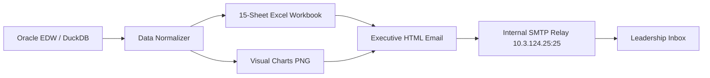

# 🚀 KG Recharge Tracker — Quick Project & Operations Guide

A simple, fast, and practical reference guide for operating the **Daily Gross Add (KG) Recharge Tracker** email and reporting workflow.

---

## 💡 What the Workflow Does

`send_kg_email.py` is an autonomous reporting pipeline for Safaricom Ethiopia's Commercial and CVM leadership:

1. **Fetches Daily Cohort Data**: Extracts National and Regional SIM activation data (excluding micro-advances under 4 Birr) tracking Day 0 through Day 60 recharge velocity.
2. **Dual-Source Database Engine**: Queries Oracle EDW in production and seamlessly falls back to a high-speed local DuckDB database (`data/dummy_database.duckdb`) if Oracle is unreachable.
3. **Synthesizes a 15-Sheet Excel Workbook**: Builds an enterprise workbook containing weekly executive rollups, daily cohort details, regional division matrices, and individual regional drill-down sheets with native `=AVERAGEIFS` and `=SUM` Excel formulas.
4. **Renders Executive Dashboard Visuals**: Generates high-res Matplotlib chart dashboards comparing national trajectory against targets (30%, 40%, 50%, 60%, 70%, 90%) and ranking regional 20-day conversion.
5. **Constructs & Sends Executive Email**: Formats an Outlook-safe responsive HTML email with KPI summary cards, Day-on-Day delta badges, regional leaderboard, and attaches the complete Excel workbook.



---

## 🛠️ Quick Setup

### 1. Requirements
- Windows 10/11 or Windows Server.
- Python 3.12+ (or installed automatically via `uv`).
- `uv` package manager (recommended for fast, reproducible virtual environments).

### 2. Install Dependencies
Open PowerShell in the project directory:

```powershell
cd "c:\Users\Mekin.Jemal\OneDrive - Safaricom Ethiopia\Desktop\Automation\kg"
uv sync --link-mode copy
```

> [!TIP]
> The `--link-mode copy` flag prevents Windows filesystem hardlink conflicts when running inside cloud-synced directories like OneDrive.

---

## ⚙️ Configuration (`.env`)

Configure your local `.env` file in the `kg/` root directory. All credentials and network endpoints stay local:

```dotenv
# ==========================================
# Database Configuration (Oracle EDW)
# ==========================================
ORACLE_USER=svc-cbu-pam9
ORACLE_PASSWORD=your_secure_password
ORACLE_DSN=et02-alpha-exadb01.safaricomet.net:1521/EDWBIPR.safaricomet.net
KG_EMAIL_SOURCE=duckdb

# ==========================================
# Safaricom Internal SMTP Relay Configuration
# ==========================================
SMTP_HOST=10.3.124.25
SMTP_PORT=25
EMAIL_FROM=Mekin.Jemal@safaricom.et
REPORT_EMAIL_TO=Mekin.Jemal@safaricom.et
REPORT_EMAIL_CC=

# ==========================================
# Reporting Parameters
# ==========================================
KG_EXCLUDE_4BIRR=true
```

> [!NOTE]
> Safaricom's internal SMTP relay (`10.3.124.25:25`) uses **IP-based whitelisting**. No username, password, SSL, or TLS is required. If sending fails, check that your runner machine's IP is whitelisted by the network team.

---

## 🏃 Running the Workflow

### Mode 1: Local DuckDB Simulation (Offline / Safe Preview)
Test the entire pipeline locally in under 3 seconds without touching Oracle or sending emails:

```powershell
uv run python send_kg_email.py --source duckdb --preview-only
```
- ✅ Extracts 204 national & 810 regional rows from DuckDB.
- ✅ Creates the full 15-sheet Excel workbook in `reports/excel/`.
- ✅ Generates the visual charts in `reports/charts/`.
- ✅ Builds standalone HTML email previews in `reports/previews/` (`desktop_preview.html` and `mobile_preview.html`).

### Mode 2: Oracle Production Extraction (Preview Mode)
Verify the production Oracle EDW queries without dispatching email:

```powershell
uv run python send_kg_email.py --source oracle --preview-only
```

### Mode 3: Send Email through SMTP Relay
Dispatch the executive email with embedded dashboard charts and the attached Excel report:

```powershell
# Send using DuckDB dataset
uv run python send_kg_email.py --source duckdb --send

# Send using Oracle EDW production data
uv run python send_kg_email.py --source oracle --send

# Send to a specific recipient (override .env)
uv run python send_kg_email.py --source oracle --send --recipient "Leadership@safaricom.et"
```

---

## 📂 Outputs & Code Map

### Generated Files
| Output Path | Description |
| :--- | :--- |
| `reports/excel/KG_Recharge_Tracker_*.xlsx` | 15-sheet formula-linked Excel master workbook |
| `reports/previews/desktop_preview.html` | Full desktop browser preview of executive email |
| `reports/previews/mobile_preview.html` | Responsive mobile preview (380px container) |
| `reports/charts/kg_dashboard_*.png` | High-res 2-panel KPI and regional leaderboard visual chart |

### Source Code Map
| Module | Responsibility |
| :--- | :--- |
| [send_kg_email.py](file:///c:/Users/Mekin.Jemal/OneDrive%20-%20Safaricom%20Ethiopia/Desktop/Automation/kg/send_kg_email.py) | CLI entry point supporting `--source`, `--preview-only`, `--send`, and `--recipient` |
| [src/kg/services/runner.py](file:///c:/Users/Mekin.Jemal/OneDrive%20-%20Safaricom%20Ethiopia/Desktop/Automation/kg/src/kg/services/runner.py) | 5-stage pipeline orchestrator coordinating query $\rightarrow$ Excel $\rightarrow$ chart $\rightarrow$ email |
| [src/kg/services/database.py](file:///c:/Users/Mekin.Jemal/OneDrive%20-%20Safaricom%20Ethiopia/Desktop/Automation/kg/src/kg/services/database.py) | Dual-source database connector, query sanitizer, and schema normalizer |
| [src/kg/services/excel_report.py](file:///c:/Users/Mekin.Jemal/OneDrive%20-%20Safaricom%20Ethiopia/Desktop/Automation/kg/src/kg/services/excel_report.py) | Multi-tab OpenPyXL Excel generator with live formulas (`=AVERAGEIFS`, `=SUM`) |
| [src/kg/services/visual_charts.py](file:///c:/Users/Mekin.Jemal/OneDrive%20-%20Safaricom%20Ethiopia/Desktop/Automation/kg/src/kg/services/visual_charts.py) | Matplotlib chart renderer with Safaricom branding and target benchmark lines |
| [src/kg/services/email_template.py](file:///c:/Users/Mekin.Jemal/OneDrive%20-%20Safaricom%20Ethiopia/Desktop/Automation/kg/src/kg/services/email_template.py) | Responsive MSO Outlook-compatible HTML email template builder |
| [src/kg/services/email_service.py](file:///c:/Users/Mekin.Jemal/OneDrive%20-%20Safaricom%20Ethiopia/Desktop/Automation/kg/src/kg/services/email_service.py) | Modern Python `EmailMessage` SMTP dispatcher via IP-authorized relay |
| [config/settings.py](file:///c:/Users/Mekin.Jemal/OneDrive%20-%20Safaricom%20Ethiopia/Desktop/Automation/kg/config/settings.py) | Canonical regions, conversion targets, corporate colors, and file paths |

---

## ⏰ Automated Scheduling (Windows Task Scheduler)

The repository includes a ready-to-use Windows batch script: [`daily_kg_email.bat`](file:///c:/Users/Mekin.Jemal/OneDrive%20-%20Safaricom%20Ethiopia/Desktop/Automation/kg/daily_kg_email.bat).

### Setting up a Daily Scheduled Task
1. Open Windows **Task Scheduler** (`taskschd.msc`).
2. Click **Create Basic Task...** $\rightarrow$ Name it `Safaricom_KG_Recharge_Tracker`.
3. Set Trigger: **Daily at 07:30 AM** (after Oracle EDW nightly ETL finishes).
4. Set Action: **Start a program**.
   - **Program/script**: `C:\Windows\System32\cmd.exe`
   - **Add arguments**: `/c "c:\Users\Mekin.Jemal\OneDrive - Safaricom Ethiopia\Desktop\Automation\kg\daily_kg_email.bat"`
   - **Start in**: `c:\Users\Mekin.Jemal\OneDrive - Safaricom Ethiopia\Desktop\Automation\kg`
5. Check **Run whether user is logged on or not** with highest privileges.

---

## 🔍 Troubleshooting & FAQ

### 1. `ORA-00933: SQL command not properly ended`
- **Cause**: Oracle DB-API (`oracledb`) rejects trailing semicolons (`;`) in queries.
- **Solution**: The engine automatically strips trailing semicolons via `.rstrip("; \r\n\t")` in `database.py`. Ensure raw `.sql` files do not have multiple SQL statements in one file.

### 2. `ORA-00942: table or view does not exist`
- **Cause**: The Oracle session user (`svc-cbu-pam9`) does not own the tables in their default schema.
- **Solution**: All queries must prefix the table with the owner schema: `BETELHEM_GIRMA.TBL_DAILY_SECOND_RECHARGE_COHORT_RPT`. This is already configured in `sql/regional_cohort.sql`.

### 3. `KeyError: 'WEEK'`
- **Cause**: Oracle returns column names like `DAY_LABEL` (`WK2 Tuesday`) rather than a dedicated `WEEK` column.
- **Solution**: The pipeline's `normalize_cohort_dataframe()` handles this automatically by regex-extracting `WK[0-9]+` from `DAY_LABEL` or computing it dynamically from `ACTIVATION_DATE`.

### 4. `SMTP connection refused` or `timed out`
- **Cause**: The runner computer cannot reach the internal relay `10.3.124.25:25`.
- **Solution**: 
  1. Check VPN or on-premise Safaricom network connection.
  2. Test port connectivity in PowerShell: `Test-NetConnection -ComputerName 10.3.124.25 -Port 25`.
  3. Ensure the runner's IP address has been whitelisted for SMTP relay.

### 5. `PermissionError: [Errno 13] Permission denied: '...xlsx'`
- **Cause**: The destination Excel workbook is currently open in Microsoft Excel.
- **Solution**: Close Excel before running the pipeline or allow the pipeline to append a timestamped filename.

